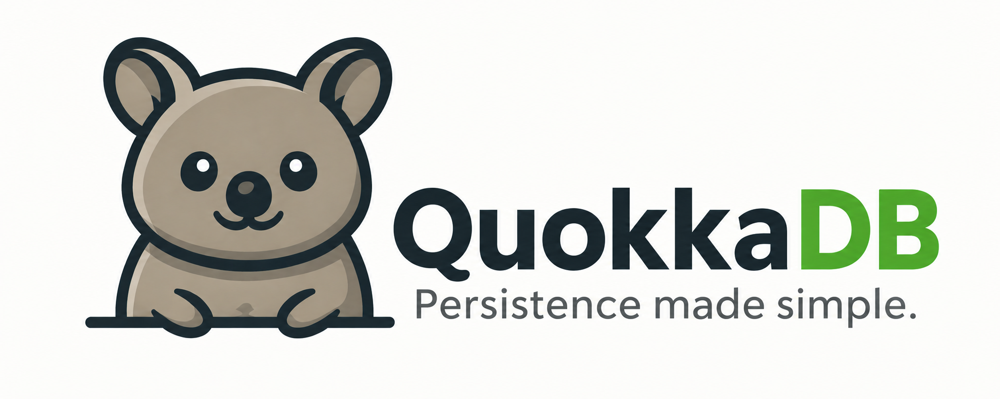
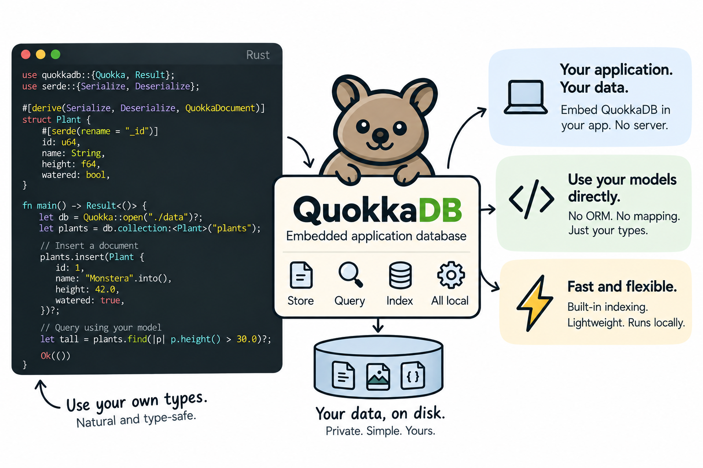
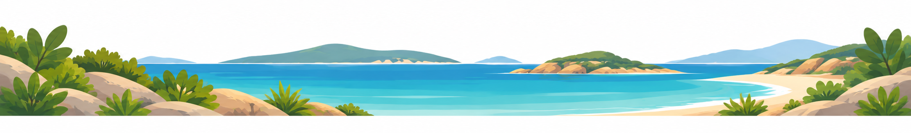

<p style="text-align: left;">
  
</p>

# QuokkaDB

**The embedded application database.**

QuokkaDB is an embedded application database for **Rust**, with Python and Node.js/TypeScript support planned. It lets you persist your application models directly, without running or managing a database server.

<p style="text-align: left;">
  
</p>


## Persist your models, not your mappings

Applications are built from nested objects, collections, and evolving state. **QuokkaDB stores that structure directly**, without decomposing your models into tables, joins, and mapping layers.

## Persistence without infrastructure

- **No server** — QuokkaDB runs inside your application.
- **Single directory** — all database files live in one place.
- **No setup** — open a path and start storing data.
- **Flexible schema** — evolve your documents with your application models.
- **No mapping layer** — persist nested application models directly.
- **Small and bounded** — designed for predictable application-level resource usage.
- **Real database semantics** — durability, indexes, concurrent access, atomic document writes, and crash recovery.

QuokkaDB is designed to make persistence a boring part of building an application.

## When to use QuokkaDB

Choose QuokkaDB when you need **local application persistence without database infrastructure**.

* Persist and query your models directly.
* No database server to deploy or operate.
* Flexible nested data without mapping it to tables.
* Built for desktop apps, developer tools, agents, edge applications, and local services.

For shared, multi-node database workloads, use a server database.

## Quick start

Add QuokkaDB and the dependencies used by the examples to your `Cargo.toml`:

```toml
[dependencies]
quokkadb = "0.1.0"
serde = { version = "1", features = ["derive"] }
```

```rust
use quokkadb::{QuokkaDB, QuokkaDocument, QuokkaId, Result};
use serde::{Deserialize, Serialize};

#[derive(Serialize, Deserialize, QuokkaDocument)]
struct Plant {
    #[serde(rename = "_id")]
    id: QuokkaId,
    name: String,
    needs_water: bool,
}

fn main() -> Result<()> {
    let db = QuokkaDB::open("./data")?;
    let plants = db
        .typed_collection::<Plant>("plants")
        .create_if_missing();

    plants.insert_one(Plant {
        id: QuokkaId::new(),
        name: "Monstera".into(),
        needs_water: true,
    })?;

    let plant = plants
        .find_one(|plant| plant.needs_water.eq(true))?
        .expect("inserted plant must exist");

    assert_eq!(plant.name, "Monstera");
    Ok(())
}
```

`QuokkaDB` implements `Clone`. Clones share the same database instance, so you can pass a clone to another thread when your application needs it.

For dynamic data or lower-level access, QuokkaDB also exposes a BSON document API.

## Documentation

[Read the QuokkaDB documentation.](docs/README.md)

The documentation covers the document and typed APIs, queries, indexes, configuration, database internals, and current limitations.

## Platform Support

QuokkaDB is designed to be portable across desktop, server, and mobile platforms.

| Platform | Status |
|---|---|
| Linux (x86-64) | Tested |
| Windows (x86-64) | Tested |
| macOS (ARM64) | Tested |
| Android (ARM64) | Experimental |
| iOS (ARM64) | Experimental |

Platform compatibility is continuously validated through automated CI tests. Mobile support is still experimental and has not yet undergone extensive device-level reliability testing.

## Contributing

QuokkaDB is still evolving, and real-world feedback is especially valuable.

If you try it, I’d love to hear what works, what feels awkward, and which workloads matter to you. Bug reports, small fixes, documentation improvements, and larger contributions are all welcome.

Read the [Project page](docs/project.md) for stability expectations and contribution guidance.

***Thanks for helping QuokkaDB grow!*** &#x1F331;

## License

Apache License 2.0.

<p align="center">
  
</p>
