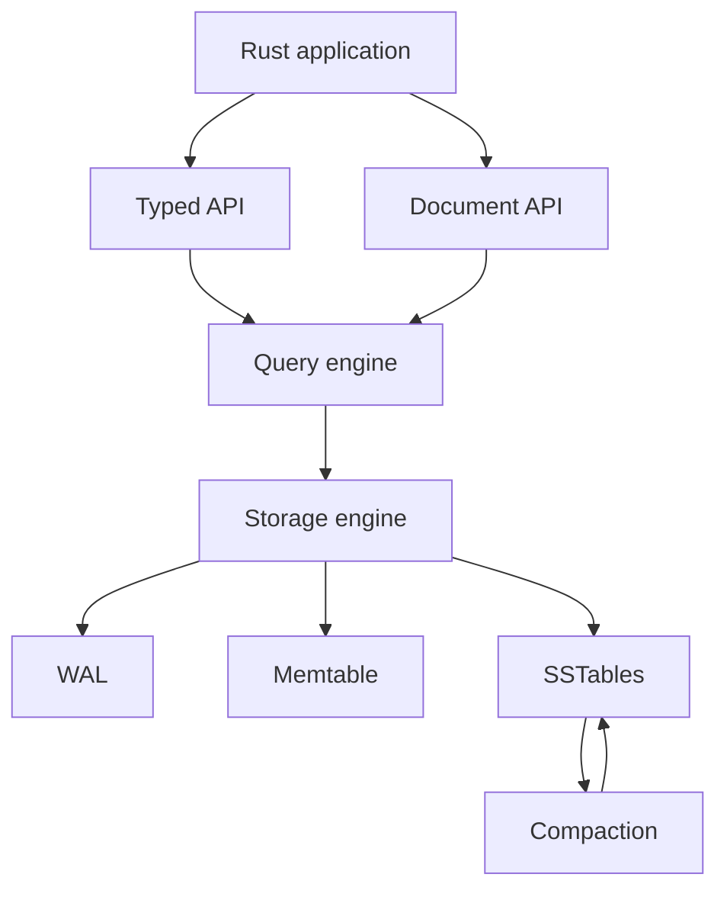
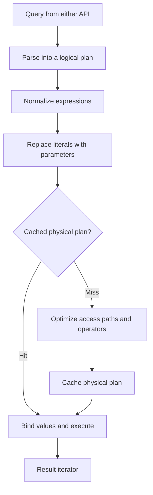

# Architecture

QuokkaDB keeps persistence inside the Rust application that uses it. A typed collection turns Rust models and typed expressions into database operations; a document collection accepts BSON documents and query specifications. Both APIs use the same query and storage layers underneath.

For example, this typed query stays inside the application process from the collection handle to the returned model:

```rust
let plant = db
    .typed_collection::<Plant>("plants")
    .find_one(|plant| plant.needs_water.eq(true))?;
```

## Main layers



The public APIs create collection operations. The query engine translates them into executable plans, and the storage engine provides versioned records and atomic write batches.
The storage engine owns the database directory. It accepts writes through the write-ahead log and in-memory tables, and moves older data into on-disk sorted tables. Background flushing and compaction organize those files without changing the API used by the application.

## One storage engine

Collections and indexes share a single LSM storage engine. Document records and index entries use the same WAL, memtable, SSTable, flushing, and compaction machinery; QuokkaDB does not maintain a separate persistence subsystem for indexes.

When a write changes a document, the corresponding index entries are updated through the same write path. This lets index maintenance participate in the atomicity of that document write. The catalog describes collections and indexes and informs query planning and execution, but it is metadata at the query/storage boundary rather than another storage output alongside the WAL or SSTables.

## Query planning and plan reuse

Both APIs feed the same query pipeline. Typed field expressions provide a Rust interface to query construction; the document API supplies BSON query specifications directly. Parsing produces a logical plan describing the requested operation.



Normalization simplifies the logical expressions before optimization. Parameterization separates literal values from the query structure, so compatible queries with different values can reuse an optimized physical plan. The cache key includes the collection identity, collection version, and parameterized logical-plan hash.

The cache stores plans, not query results. Each execution binds its own values and reads under its own snapshot. Collection versions keep plans for different metadata versions separate.

The optimizer chooses access paths such as primary-key lookups, index scans, or collection scans, and adds filtering, projection, sorting, and limits where needed. An index can narrow the candidate records without satisfying every filter; remaining predicates are evaluated during execution. This diagram describes cached reads; writes use the separate execution path described below.

## How a read works

1. The typed API expresses the query through Rust model fields and serializes its filter values into the database representation. The document API starts with BSON values directly.
2. The query engine normalizes and parameterizes the logical plan, then obtains a physical plan from the cache or optimizer.
3. The executor acquires a snapshot and runs the plan. Filtering, projection, sorting, and limiting can be composed around the storage access.
4. Results are returned as BSON documents or deserialized back into the requested Rust type.

Records are versioned by sequence number. A read uses a snapshot sequence number to select the versions visible at query start, providing multi-version concurrency control while concurrent writes continue. The snapshot remains active while the result iterator is consumed, so later writes do not change that query's view.

A range scan merges ordered records from the active memtable, immutable memtables waiting for flush, and relevant SSTables. Version selection keeps the newest record visible to the snapshot for each key. A visible deletion marker suppresses the record rather than exposing an older value. Point reads use the same snapshot visibility rule without requiring a full range scan.

Keeping a result iterator alive also keeps its snapshot lease alive. Long-lived snapshots can delay reclamation of older versions during compaction, even when newer queries no longer need those versions.

### Execution and memory

Read operators compose iterators. Filtering and projection process incoming documents, while skip and limit control how many results pass downstream. Most document-level filtering and projection currently operate on deserialized BSON documents; typed results are deserialized into the requested Rust type after query execution.

Sorting can require consuming the candidate input before returning the first result. The executor supports in-memory sorting, external merge sorting with temporary files, and a top-k heap for bounded results. These strategies share comparison semantics, but differ in memory use and temporary I/O. A top-k sort retains a bounded set of candidates while still examining its input; a limit alone does not guarantee that only that many records are read. An access path that already supplies the required order can avoid a separate sort.

The selected strategy depends on the physical plan. Treat optimizer choices as implementation details rather than guarantees for a particular query. Collecting an iterator into a vector also materializes all returned results in application memory.

Read [Concepts](concepts.md#queries-updates-and-indexes) for query semantics and [Features](features.md#querying) for the supported query surface.

## How a write works

Insert, update, replace, and delete operations also become plans, but they are executed as writes rather than cached read iterators. Updates and deletes read matching documents from a consistent snapshot, calculate each change, and prepare one write batch per document. Concurrent changes are checked before each batch is committed.

The storage engine coordinates writers and checks batch preconditions, including expected document versions, before committing changes. This prevents an update computed from an older snapshot from silently overwriting a conflicting change. A batch contains the document changes and their corresponding index changes.

Each accepted batch receives a sequence number, is appended to the write-ahead log, and is applied to the current memtable. After completing the required WAL work, the engine advances the sequence visible to new snapshots. A batch commits as a whole or returns an error; a multi-document operation can have earlier batches committed when a later batch fails. The configured `WalDurability` controls when each recovery record is considered durable; `sync()` applies to every batch in the operation.

Visibility and durability describe different properties: publication controls what new readers can see, while WAL synchronization controls what survives a crash. A durable acknowledgment does not require the document to have reached an SSTable.

As the in-memory table grows, QuokkaDB rotates it and schedules a flush to an on-disk sorted table. Compaction later merges files and removes obsolete versions when active snapshots no longer need them. These maintenance tasks are separate from the query and write APIs.

See [Concepts — Concurrent access and atomic writes](concepts.md#concurrent-access-and-atomic-writes), [Concepts — Durability and recovery](concepts.md#durability-and-recovery), and [Operations](operations.md) for the user-visible guarantees.

## Opening and recovery

`QuokkaDB::open` opens the application-owned database directory and restores the database state. If the application or process stops unexpectedly, reopening the same directory replays the available recovery records according to the selected durability mode.

Opening an existing directory first recovers its manifest, which records the persisted storage layout and catalog metadata. The engine restores the referenced sorted-table state and replays the remaining WAL records to rebuild changes not yet represented in that state. Recovery also restores the sequence ordering used for visibility. It does not reconstruct the database by replaying every write since its creation.

QuokkaDB is embedded and has no database server or network protocol. The documented sharing model is to clone one opened `QuokkaDB` handle across threads in the same process. Keep the directory owned by that application process while it is running; see [Operations — Own the database directory](operations.md#own-the-database-directory).

See [Features](features.md#not-supported) for the current unsupported surface and [Project](project.md#current-development-stage) for compatibility and stability expectations.
