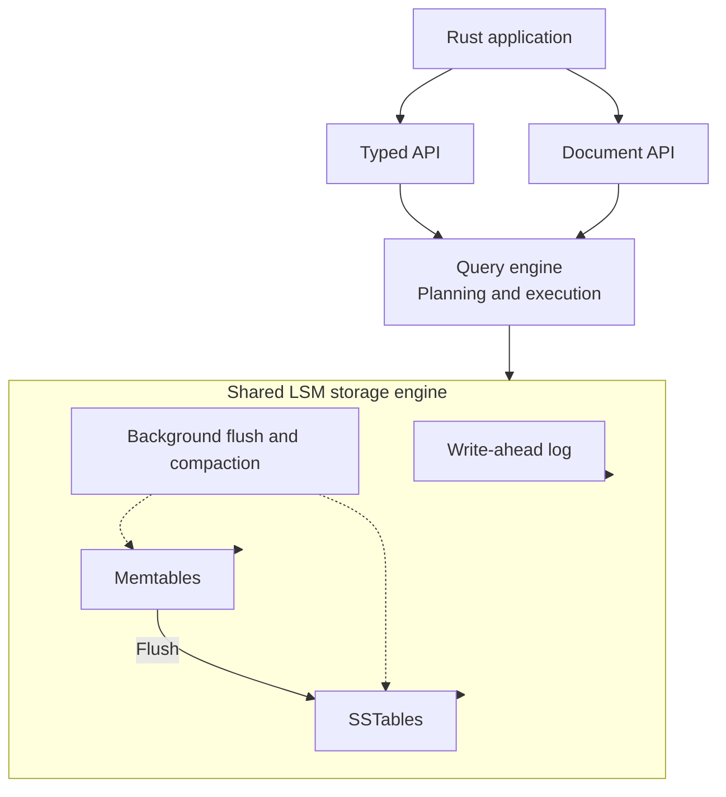
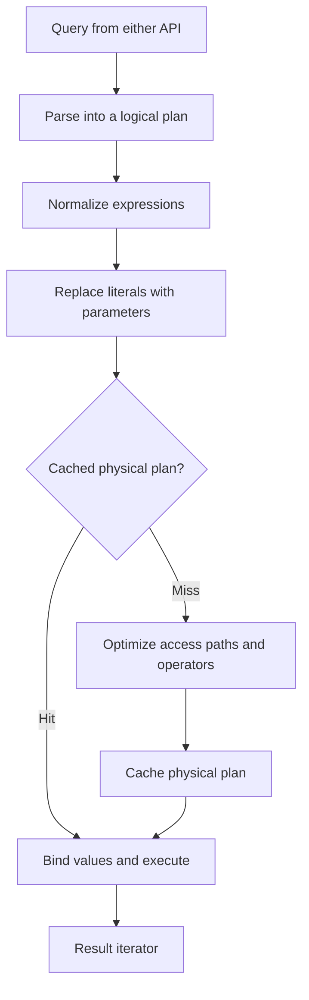

# Architecture

QuokkaDB is an embedded document database that keeps persistence inside the Rust application using it. Applications can work directly with Rust models through a typed API or with BSON documents through a document API. Both interfaces share the same query engine, indexes, concurrency model, and storage engine.

For example, a typed query runs entirely inside the application process:

```rust
let plant = db
    .typed_collection::<Plant>("plants")
    .find_one(|plant| plant.needs_water.eq(true))?;
```

The architecture is guided by a few choices:

- **Share resources across collections and indexes.** A single LSM tree provides a common write path, cache, and background maintenance machinery, making resource usage easier to manage for an embedded application.
- **Keep the application interface simple without simplifying the engine.** Typed expressions and BSON queries use the same query planner and executor.
- **Allow concurrent reads and writes.** Snapshot-based reads provide stable views while optimistic preconditions protect read-modify-write operations against conflicting changes.
- **Separate visibility from durability.** A committed write can become visible before reaching an SSTable; WAL durability determines which accepted writes survive a crash.

These choices favor centralized resource management and straightforward application integration. They also involve trade-offs: shared storage resources provide less isolation between busy collections, and optimistic writes may need to retry under contention.

## Main layers



The public APIs translate collection operations into query and write plans. The query engine selects access paths and executes operations. The storage engine maintains versioned records, atomic write batches, and the files in the application's database directory.

The catalog tracks collection and index metadata used by planning and execution. It is metadata at the query/storage boundary, not a separate persistence engine.

## A shared storage engine

Collections and secondary indexes occupy the same LSM tree. Document records and index entries use the same WAL, memtables, SSTables, flush, and compaction machinery. There is no independent tree or persistence subsystem for each collection or index.

This decision has two important consequences.

**Atomic index maintenance.** When a document changes, QuokkaDB prepares the corresponding index changes in the same write batch. A committed document change and its index maintenance therefore share the same atomic write boundary.

**Centralized resource management.** A common memtable and storage infrastructure avoids per-collection or per-index write-buffer allocations. Cache capacity, flush pressure, and background maintenance can be managed across the database rather than by a growing number of independent storage engines. Creating another collection or index does not require creating another LSM tree.

This does not mean all database memory is strictly bounded: query operators, active snapshots, returned results, metadata, and other allocations also consume memory. Nor does a single tree automatically provide isolation. Heavy writes to one collection can increase flush or compaction pressure for other collections. Multiple-tree designs can also share caches and budgets; QuokkaDB's choice makes that sharing part of the basic storage model.

### Flushing and compaction

Writes first enter the WAL and active memtable. When the memtable reaches its configured threshold, it becomes immutable and is scheduled for flushing into SSTables. Background compaction merges sorted files and reclaims obsolete versions when snapshots no longer require them.

Compaction is internal maintenance: applications continue to use the same query and write APIs while files are reorganized. Shared scheduling also means compaction work must balance the needs of collections using the same tree.

## Query planning and plan reuse

Typed expressions and BSON query specifications enter the same query pipeline. The typed API provides compile-time-checked field access where supported; the document API provides dynamic query construction. Both produce logical plans for the query engine.



Normalization simplifies query expressions before optimization. Parameterization separates literal values from query structure, allowing compatible queries with different values to reuse a physical plan. The plan-cache key includes the collection identity, collection version, and a hash of the parameterized logical plan.

The optimizer can choose primary-key lookups, secondary-index scans, or collection scans and compose them with filtering, projection, sorting, and limit operators. An index scan may only narrow the candidate set; residual predicates are still evaluated during execution.

The cache stores **plans, not results**. Every execution binds its own parameter values and obtains its own read snapshot. Collection versions distinguish plans built for different metadata versions.

Plan reuse trades repeated optimization work for potentially less value-specific access-path choices: the best plan for one set of filter values is not necessarily the best for another. The selected plan is an implementation choice rather than a performance guarantee. The diagram describes cached reads; writes follow a separate execution path.

## How a read works

1. The typed API constructs a query from Rust model fields and serializes filter values into the database representation; the document API starts with BSON values.
2. The query engine normalizes and parameterizes the logical plan, then retrieves or optimizes a physical plan.
3. The executor acquires a snapshot and runs that plan using storage access and iterator operators.
4. The result is returned as BSON documents or deserialized into the requested Rust type.

### Snapshot visibility

Records have sequence-numbered versions. A query uses a snapshot sequence number to see the database as of its starting point, even as other threads commit writes. Its snapshot remains active while its result iterator is consumed.

A range scan merges ordered records from the active memtable, immutable memtables, and relevant SSTables. For each key, version selection returns the newest version visible to the snapshot. A visible deletion marker hides the key rather than exposing an older value. Point reads obey the same visibility rules without requiring a full range scan.

This makes read iteration stable under concurrent writes, but has a storage cost: keeping an iterator alive also keeps its snapshot lease alive. Long-lived snapshots can delay reclamation of older versions during compaction.

### Execution and memory

Read operators compose iterators. Filtering and projection process documents as they arrive; skip and limit control the returned stream. Most document-level filtering and projection currently operate on deserialized BSON documents, and typed results are deserialized after query execution.

Sorting is different because it may need to examine all candidates before producing a result. QuokkaDB supports in-memory sorting, external merge sorting using temporary files, and bounded top-k heaps. An index that already supplies the requested ordering may eliminate the sort operator entirely.

A top-k sort bounds the retained candidate set but must still inspect its input. Similarly, a limit does not guarantee that only the requested number of documents will be read. Collecting an iterator into a vector also materializes all returned results in application memory.

For supported query behavior, see [Concepts](concepts.md#queries-updates-and-indexes) and [Features](features.md#querying).

## How a write works

Insert, update, replace, and delete operations are executed through a write path rather than through cached read iterators. `insert_one` and `insert_many` prepare one atomic batch for each operation; `insert_many` puts all of its documents and index changes in that single batch. Single-document updates, replacements, and deletes also use one batch per operation. `update_many` and `delete_many` locate matching documents under one consistent snapshot, compute their changes, and prepare **one atomic batch per document**. Each batch contains the document change and the corresponding index changes.

QuokkaDB uses optimistic concurrency for these read-modify-write operations. Writers can find documents and compute changes without holding an exclusive write lock for the entire operation. At commit, the storage engine coordinates writers and validates batch preconditions, including the versions of documents being modified.

If a document has changed since the operation read it, the precondition prevents an outdated modification from silently overwriting that change. Single-document update, replace, and delete operations automatically retry a version conflict with a fresh snapshot and backoff, subject to a five-second retry timeout. Multi-document update and delete operations keep their original snapshot and can return an error after earlier document batches have committed. This is document-version conflict detection; it should not be confused with a general guarantee that all predicates or unrelated reads are transactionally validated.

For each accepted batch, the engine assigns a sequence number, appends its recovery record to the WAL, and applies it to the memtable. Once the required WAL work is completed, the engine advances the sequence visible to new snapshots.

**Atomicity is per batch.** A batch commits as a whole or returns an error. `insert_many` uses one batch, so all of its document and index changes share one atomic boundary. `update_many` and `delete_many` submit separate batches for matching documents, so earlier documents may have committed before a later batch fails.

### Visibility and durability

Visibility determines when readers can observe a write. Durability determines whether the write survives a crash. A write need not reach an SSTable to be durable because WAL recovery can reconstruct changes not yet flushed.

The configured `WalDurability` controls when recovery records are considered durable. The `sync()` setting applies to each submitted batch: `insert_many` submits one batch, while `update_many` and `delete_many` may submit one batch per matching document. The durability mode therefore matters when interpreting what a successful write acknowledgment guarantees after a crash.

See [Concepts — Concurrent access and atomic writes](concepts.md#concurrent-access-and-atomic-writes), [Concepts — Durability and recovery](concepts.md#durability-and-recovery), and [Operations](operations.md) for the public guarantees.

## Opening and recovery

`QuokkaDB::open` opens the application's database directory and restores the persisted state. It first recovers the manifest, which describes the persisted storage layout and catalog metadata, and restores the referenced SSTables. It then replays the remaining WAL records to reconstruct changes not yet represented in those tables and restore the sequence ordering used for visibility.

Recovery does not replay the full history of the database. Its outcome after an unexpected stop depends on which recovery records were made durable under the selected mode. For details on supported durability guarantees and recovery behavior, see [Concepts — Durability and recovery](concepts.md#durability-and-recovery).

QuokkaDB has no database server or network protocol. The documented sharing model is to clone one opened `QuokkaDB` handle across threads within a process. The application should keep ownership of the database directory while it is running; see [Operations — Own the database directory](operations.md#own-the-database-directory).

For compatibility and development-stage expectations, see [Features](features.md#not-supported) and [Project](project.md#current-development-stage).
